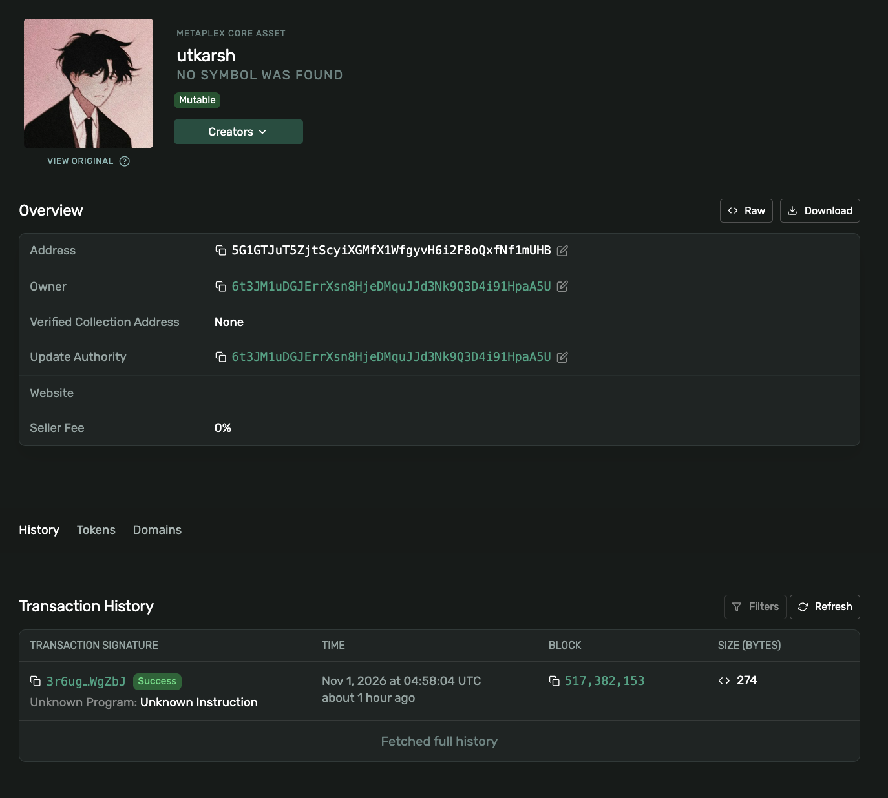
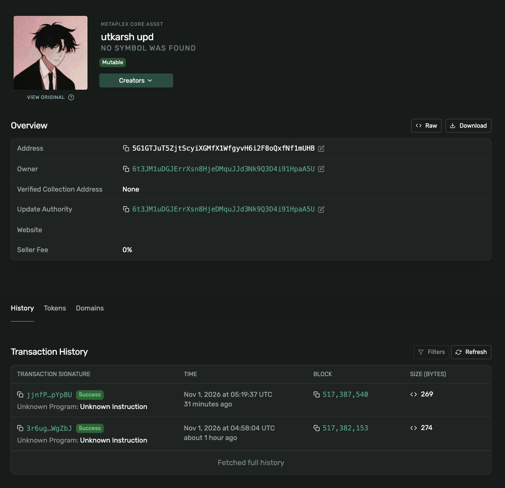
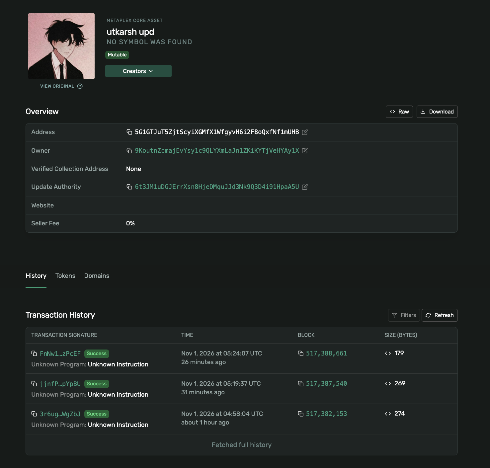
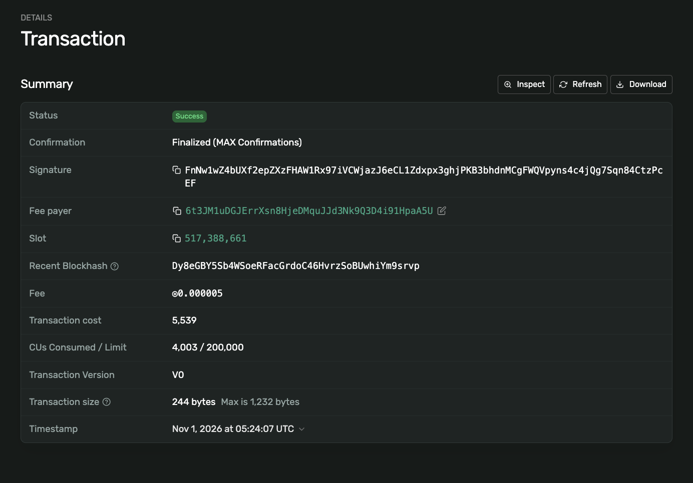
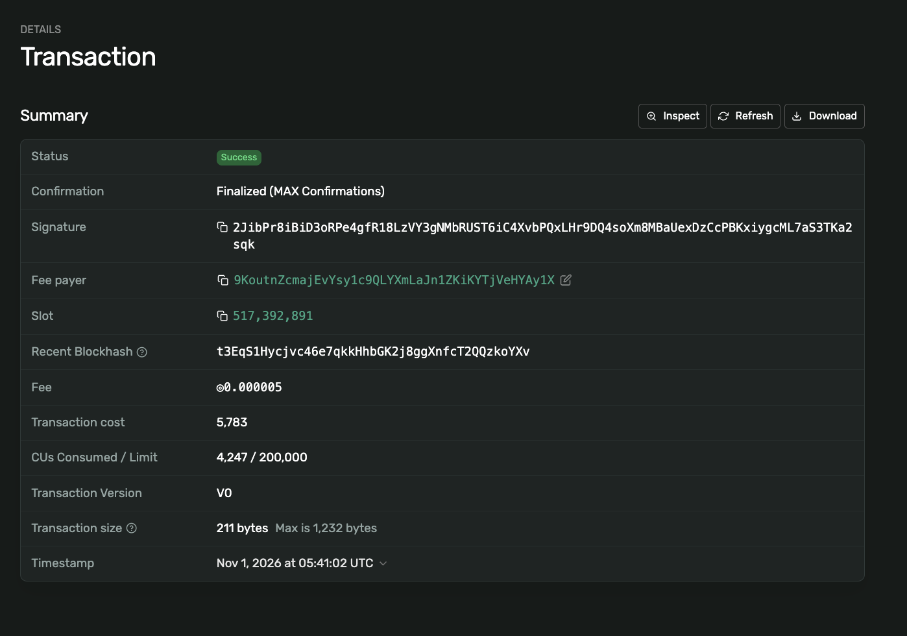
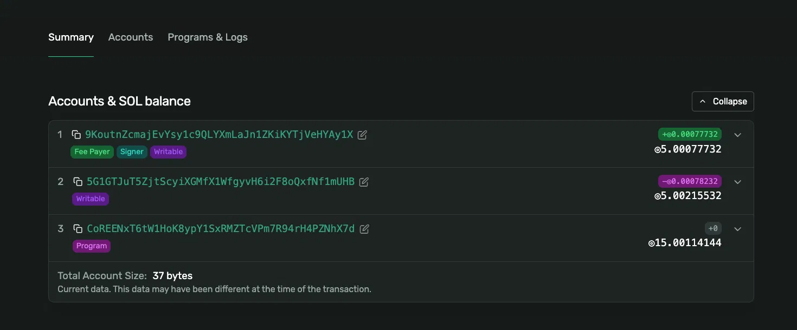
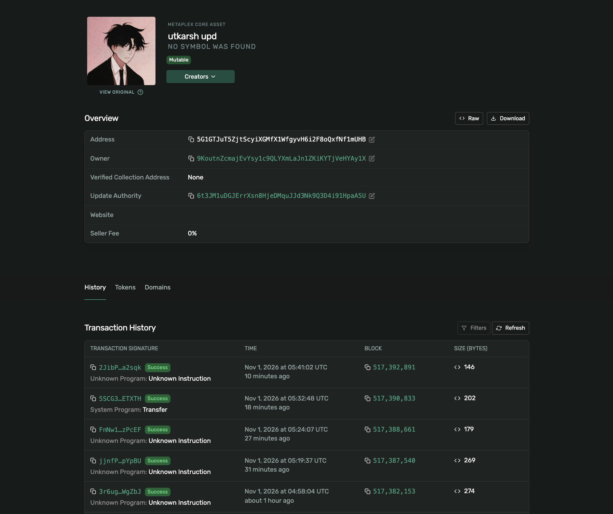

# Turbin3 Week 1: SPL Token + MPL Core NFT (Solana devnet)

Week 1 assignment for Turbin3. Mint and transfer an SPL token, then mint, update, transfer and burn an NFT using Metaplex MPL Core. Everything runs on **devnet**, with TypeScript scripts, one per step.

## Tasks

- [x] Task 1: Mint and transfer an SPL token
- [x] Task 2: Mint an NFT with MPL Core
- [x] Task 3: Update the NFT's name and metadata as the update authority
- [x] Task 4 (extension): Transfer the NFT between wallets
- [x] Task 5 (extension): Burn the NFT and reclaim the rent

Youtube Explanation Video: [https://youtu.be/wfThAvT-U9w](https://youtu.be/wfThAvT-U9w)

## Stack

- TypeScript, run with [`tsx`](https://github.com/privatenumber/tsx)
- `@solana/web3.js` (v1) and `@solana/spl-token` for the SPL token
- Metaplex Umi, `@metaplex-foundation/mpl-core` and `umi-uploader-irys` for the NFT

## Setup

```bash
git clone <this-repo>
cd turbin3-week1-solana-spl-core-nft
npm install
```

Generate two wallets: a main wallet (payer, mint authority, update authority, first NFT owner) and a recipient. The script refuses to overwrite an existing file.

```bash
npx tsx src/keygen.ts wallet.json
npx tsx src/keygen.ts recipient.json
```

Fund the **main** wallet with devnet SOL at https://faucet.solana.com (select Devnet, paste the main wallet's public key), then check the balance:

```bash
npx tsx src/balance.ts
```

The recipient needs devnet SOL only for Task 5, because the current owner signs the burn and pays the fee.

> `wallet.json` and `recipient.json` contain secret keys and are gitignored. Never commit them.

## Project structure

```
assets/
  nft.jpg                   # NFT image
src/
  helpers.ts                # loadWallet() and shared devnet connection
  keygen.ts                 # generates a keypair file
  balance.ts                # prints the main wallet's SOL balance
  01-spl-token.ts           # Task 1: create mint, create ATA, mint tokens
  01b-transfer-spl.ts       # Task 1: transfer tokens to the recipient
  02a-upload-image.ts       # Task 2: upload the image to Irys
  02b-upload-metadata.ts    # Task 2: upload the metadata JSON to Irys
  02c-mint-nft.ts           # Task 2: mint the MPL Core asset
  03a-upload-new-metadata.ts# Task 3: upload the updated metadata JSON
  03b-update-nft.ts         # Task 3: update name + uri
  04-transfer-nft.ts        # Task 4: transfer the asset to the recipient
  05-burn-nft.ts            # Task 5: burn the asset as the new owner
```

Run the scripts in order. Some values are hardcoded between steps (the SPL mint address in `01b`, the metadata URIs in `02c`/`03b`, the asset address in `03b`, `04` and `05`). If you re-run the flow, each run of `01` and `02c` creates a new mint / asset, so replace those values with your own.

## Task 1: SPL token

```bash
npx tsx src/01-spl-token.ts      # creates a NEW mint on every run, run once
npx tsx src/01b-transfer-spl.ts  # uses the existing mint address
```

1. `createMint` creates the mint (6 decimals, main wallet is mint authority, no freeze authority).
2. `getOrCreateAssociatedTokenAccount` creates the main wallet's token account (ATA).
3. `mintTo` mints 100 tokens into that ATA.
4. The second script creates the recipient's ATA (rent paid by the main wallet) and transfers 10 tokens to it.

## Task 2: Mint an NFT with MPL Core

```bash
npx tsx src/02a-upload-image.ts
npx tsx src/02b-upload-metadata.ts
npx tsx src/02c-mint-nft.ts
```

1. The image is uploaded to Irys (devnet), which returns an image URI.
2. A metadata JSON (`name`, `description`, `image`, `attributes`, `properties`) is uploaded, which returns the metadata URI.
3. `create` from `mpl-core` mints the asset with that `name` and `uri`. In Core, an NFT is a single account: no separate mint, ATA or metadata PDA.

## Task 3: Update name and metadata

```bash
npx tsx src/03a-upload-new-metadata.ts
npx tsx src/03b-update-nft.ts
```

A new metadata JSON is uploaded (new name, description and attribute), then `update` changes the asset's `name` and `uri`. Only the update authority (the main wallet) can sign this.

## Task 4: Transfer the NFT

```bash
npx tsx src/04-transfer-nft.ts
```

`transfer` changes the asset's owner from the main wallet to the recipient. The update authority stays with the main wallet.

## Task 5: Burn the NFT

```bash
npx tsx src/05-burn-nft.ts
```

The recipient is now the owner, so the script signs with `recipient.json`. It prints the balance before and after the burn, and checks that the asset can no longer be fetched.

## Addresses and transactions

All links open on devnet.

| Item | Link |
| --- | --- |
| Main wallet | [6t3JM1uD...paA5U](https://explorer.solana.com/address/6t3JM1uDGJErrXsn8HjeDMquJJd3Nk9Q3D4i91HpaA5U?cluster=devnet) |
| Recipient wallet | [9KoutnZc...Ay1X](https://explorer.solana.com/address/9KoutnZcmajEvYsy1c9QLYXmLaJn1ZKiKYTjVeHYAy1X?cluster=devnet) |
| SPL token mint | [FXUWPzFv...HxBm](https://explorer.solana.com/address/FXUWPzFvc6LE3Ph5LopPKuckqX4iSFjfSaYi2cAjxHBm?cluster=devnet) |
| SPL mint tx (100 tokens) | [3sn9mJ4j...zQoK](https://explorer.solana.com/tx/3sn9mJ4jymCy5JEq9RncqE91CNGGxFFEUhU2oymu7VwZk5rfnsdKEbH4Q22xxTV4o2Hue2SCgqVi49jENu5wzQoK?cluster=devnet) |
| SPL transfer tx (10 tokens) | [3cthnLye...5fxZ](https://explorer.solana.com/tx/3cthnLye56MszNZAGm4ykz6rmUZWLgGGxv4wbrd32ZCuKLi8FUYjUK6L3QSg1THwhShZnJPB8SpQxWDmAxtf5fxZ?cluster=devnet) |
| NFT asset | [5G1GTJuT...mUHB](https://explorer.solana.com/address/5G1GTJuT5ZjtScyiXGMfX1WfgyvH6i2F8oQxfNf1mUHB?cluster=devnet) (burned) |
| Image | [Fwib1En3...A24X](https://gateway.irys.xyz/Fwib1En3TmkHwDTwF1hCbZ8NqRnm9d7YNKmMkxnwA24X) |
| Metadata v1 | [F6myapNh...QYUx](https://gateway.irys.xyz/F6myapNhoHga5d9Dn3KnqbvZYshgm8NnVLoTEu93QYUx) |
| Metadata v2 | [AWVU3MNa...PH49](https://gateway.irys.xyz/AWVU3MNaNcb2YonkGmrkJQzFqsusZVfeZq49TeMqPH49) |

### NFT lifecycle

| Step | Name | Owner | Update authority | Transaction |
| --- | --- | --- | --- | --- |
| Mint | `utkarsh` | main wallet | main wallet | [3r6ugUwb...WgZbJ](https://explorer.solana.com/tx/3r6ugUwbaqYF7hRhRzc2N5biHPWRgAH95M6zkoxrj5Fu8f7wTGk1DMUBFWjWwV1GJ27zCNapLd56qomsAenWgZbJ?cluster=devnet) |
| Update | `utkarsh upd` | main wallet | main wallet | [jjnfP4u5...pYpBU](https://explorer.solana.com/tx/jjnfP4u5eTCGCvkRainRabbSRRE9Wfwx2j7oHQV1gRoKjpcvKTZ1VdRPBLji7mfAhugohJBi7tLjE4p2ZwpYpBU?cluster=devnet) |
| Transfer | `utkarsh upd` | recipient | main wallet | [FnNw1wZ4...zPcEF](https://explorer.solana.com/tx/FnNw1wZ4bUXf2epZXzFHAW1Rx97iVCWjazJ6eCL1Zdxpx3ghjPKB3bhdnMCgFWQVpyns4c4jQg7Sqn84CtzPcEF?cluster=devnet) |
| Burn | n/a | n/a | n/a | [2JibPr8i...a2sqk](https://explorer.solana.com/tx/2JibPr8iBiD3oRPe4gfR18LzVY3gNMbRUST6iC4XvbPQxLHr9DQ4soXm8MBaUexDzCcPBKxiygcML7aS3TKa2sqk?cluster=devnet) |

### Rent reclaimed on burn

The burn transaction moved `0.00078232 SOL` out of the asset account. After the `0.000005 SOL` transaction fee, the recipient's balance went from `5 SOL` to `5.00077732 SOL`, a net gain of `0.00077732 SOL`. The burn transaction's page on Explorer shows the same balance changes (see screenshots below), and `fetchAsset` fails on the address after the burn.

## Screenshots

All screenshots are from Solana Explorer on devnet.

### After mint
Name `utkarsh`, owner and update authority are the main wallet, one transaction in the history.



### After update
Name is now `utkarsh upd`, still owned by the main wallet.



### After transfer
Owner is now the recipient, the update authority is still the main wallet.



### Transfer transaction


### Burn transaction
The fee payer is the recipient, because only the current owner can burn.



### Burn balance changes
The asset account loses `0.00078232 SOL` and the recipient gains `0.00077732 SOL` after the fee. The roughly `5 SOL` still shown on the asset address comes from the accidental devnet airdrop mentioned in the last screenshot's caption.



### Asset history after burn
The burn transaction is the newest entry. The `System Program: Transfer` row is a devnet SOL airdrop sent to the asset address by mistake and is unrelated to the flow. Explorer's overview card still renders the asset's last known details, but `fetchAsset` fails after the burn.



## What I learned

- A Solana keypair is the account: the public key is the address, the secret key signs transactions.
- SPL tokens: the mint defines the token (decimals, authorities), and each wallet holds its balance in an associated token account (ATA). Amounts are in base units, so with 6 decimals, 100 tokens is `100 * 10^6`.
- MPL Core makes an NFT a single account that stores owner, update authority, name and URI, so there is no mint, ATA or metadata account. That makes it cheaper and simpler than a Token Metadata NFT.
- Owner and update authority are separate roles. After the transfer, the recipient owns the asset, but only the main wallet can still update it.
- Only the current owner can burn. Burning closes the account and returns its rent to the signer.
- Every transaction costs a fee and every new account costs rent, which is why even devnet needs SOL.
- Public RPC reads can lag. Right after the transfer, my script still printed the old owner while Explorer already showed the new one, so I verified on Explorer and added a short wait before reading back.
- `ts-node` crashed with the latest TypeScript, so I switched to `tsx`.